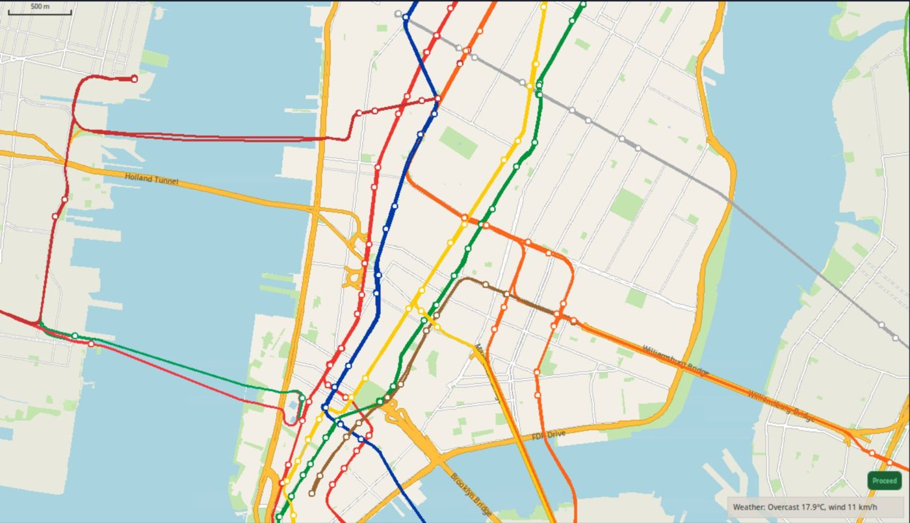
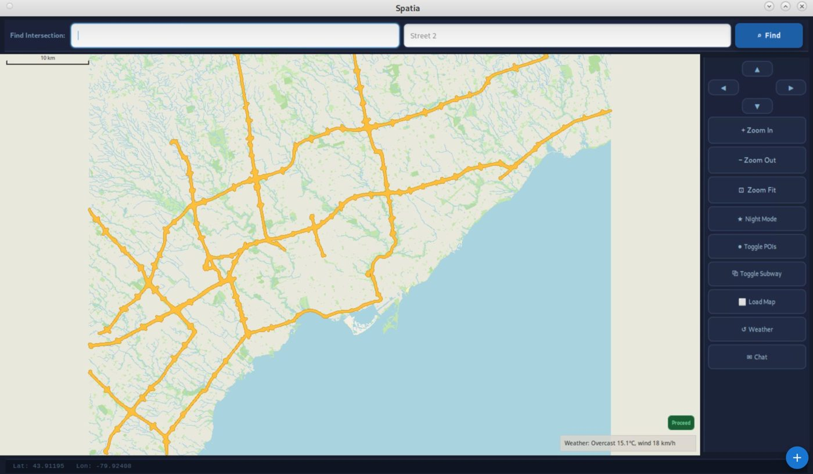
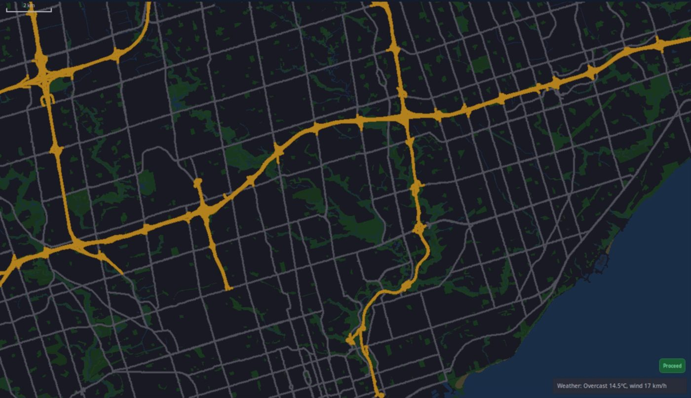
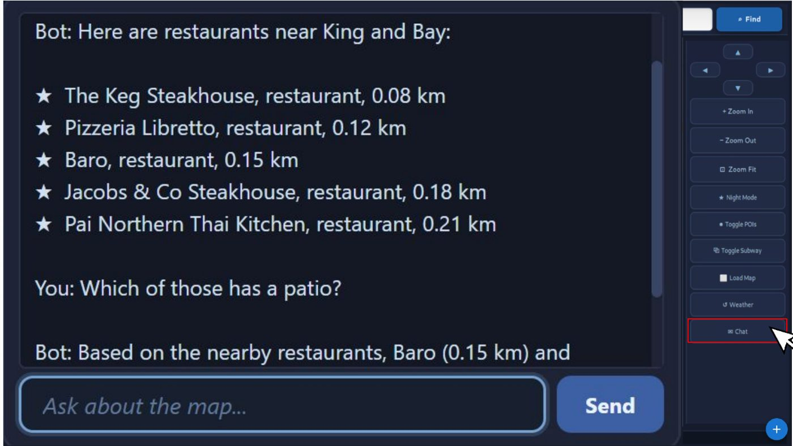

# Spatia

**A map and navigation app for tourists, built in C++.**

Spatia brings walking, transit and driving directions, live city information and an AI assistant into one fast desktop app, so someone new to a city can find their way. It was built by a team of three for ECE297 (Software Design and Communication) at the University of Toronto, January – April 2026.



## Features

- **Readable map at every zoom level.** Six levels of detail, roads ranked by colour and thickness, and labels that follow each road without overlapping.
- **Directions.** Shortest-path routing between intersections, drawn on the map with turn-by-turn steps.
- **Subway lines and stations,** each line in its own colour.
- **Points of interest,** colour-coded by type, plus speed limits for each intersection.
- **Live weather** for the area on screen, and a scale bar that adjusts as you zoom.
- **AI chatbot.** Ask questions like "which of those restaurants has a patio?" The chatbot answers using live map data and remembers the conversation.
- **Night mode** and a custom dark sidebar.

| Map | Night mode | Chatbot |
|---|---|---|
|  |  |  |

## How it works

- **Map engine.** Loads large OpenStreetMap datasets and indexes them with custom hash maps, so lookups take constant time on average.
- **Routing.** Dijkstra's algorithm and A* find shortest paths. A* can search from several starting points in one pass, searches reset in constant time between queries, and road segments are pre-computed so directions appear without delay.
- **Delivery routing.** For the course's delivery-routing challenge, the solver builds a travel-time table on eight threads, then improves the plan with eight parallel searches using adaptive large neighbourhood search, simulated annealing and local search. **The team ranked 6th out of 62.**
- **Interface.** Built with EZGL, U of T's graphics library on top of GTK 3. Weather comes from the Open-Meteo API and the chatbot uses Google's Gemini API, both called with libcurl.

## My role

I was the project manager and a developer. I owned the roadmap, ran our meetings and schedule, managed our Jira workflow and a wiki of 30+ technical specs and decisions, and kept in touch with our teaching assistants. We shipped all five milestones on time. On the engineering side, I built the core mapping engine and its hash-map indexing, implemented Dijkstra's and A* routing, and worked on the interface, weather and chatbot.

## Building and running

Spatia was developed for U of T's ECE297 lab environment (Linux), which provides the course libraries and map files.

Requirements: a C++17 compiler, `make`, GTK 3, X11, libcurl and OpenMP.

```bash
cd work/mapper
make
./mapper                       # loads the default Toronto map
./mapper path/to/map.streets.bin
```

To use the chatbot, set a Gemini API key first:

```bash
export GEMINI_API_KEY=your-key-here
```

## Team

Built by Joshua Min, Aidan and Ammar for ECE297 at the University of Toronto.

More about the project on my site: [joshmin.me](https://joshmin.me)
